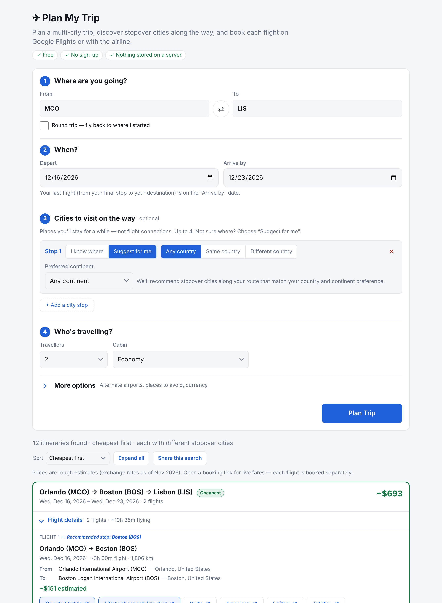

# Plan My Trip — Multi-Stop Itinerary Planner

A fully static trip planning tool. Build multi-stop itineraries, get stopover recommendations, and search flights on Google Flights and airline websites — all client-side, no backend required.

**Live:** [plan-my-trip.pages.dev](https://plan-my-trip.pages.dev)



## Features

- **Step-by-step form**: four numbered steps — where, when, cities on the way, who's travelling — then **Plan Trip** (kept on screen at the bottom on phones). Alternate airports, places to avoid and currency sit in a collapsible **More options** section whose summary shows how many are in use; it opens by itself when a shared link or an error needs it
- **Return home option**: Tick "Round trip — fly back to where I started" to end the trip back at your departure airport — the arrival field is hidden and the flight home from your last stop is on the "Return" date. Otherwise the last leg to your destination flies on the "Arrive by" date
- **Multi-stop trips**: Up to 4 city stops between departure and arrival, each either an airport you choose (with an optional "leave on" date) or "Suggest for me"
- **Stop suggestions**: Recommends hub cities (from 110 hubs) with the least detour between the neighbouring points of your route. On-route hubs (≤30% detour) are preferred; the allowed detour widens (60%, 100%, 200%) only when needed to find enough matches. Several suggested stops get distinct cities, ordered so the route never doubles back. A suggested stop is always at least 150 km from the airports either side of it (never JFK → Newark). If none fits (e.g. very short trips), you're told why
- **No repeated stopovers across itineraries**: every itinerary in a search gets its own suggested stop cities — a city shown as a stop in one result (counting all its airports, e.g. NRT/HND) never appears as a suggested stop in another. Fresh stops never widen the detour beyond what the best choices needed, so short or long multi-stop trips may show fewer results rather than far-off stopovers — and a message says why and how to get more
- **Places to avoid**: add up to 10 cities, airports or whole countries (autocomplete, or type e.g. "Paris", "LHR", "Germany", "UK"). Choosing an airport avoids its whole city. Avoided places are never suggested as stops, nearby airports or flexible-date alternatives, and you're warned if your own route uses one. Saved in the shareable link. Connections inside a single flight are chosen by the airline, so check them when booking
- **Country & continent preference** for suggested stops: same/different/any country, and a preferred continent (North America & Caribbean, South America, Europe, Asia & Middle East, Africa, Oceania). Not shown for "I know where" stops
- **Search by city, airport name or code**: "London", "Heathrow" and "LHR" all work; ties go to major hubs. Accents and punctuation don't matter ("Sao Paulo", "St Louis", "Saint Louis"). A 3-letter city name is read as the city ("Goa", "Kos", "Rio") unless typed in capitals ("GOA" = Genoa). Metro codes such as NYC, LON, PAR and TYO go to that city's main airport
- **Alternate airports**: 1–3 alternates for departure and arrival — every viable combination is compared. Always available: when your final destination is where you started, arrival alternates are other airports you would accept flying home to
- **Multiple itinerary suggestions**: Always at least 8 (up to 12) variants, sorted by estimated cost. Built from alternate airports and hub choices; if that gives fewer than 8, nearby departure/arrival airports (same country within 200 km, or another country within 100 km, so no islands or cities across the sea) and flexible dates (whole trip a few days earlier/later, never in the past) are added and labelled
- **Sorting**: results can be sorted by cost, fewest flights or shortest flying time
- **Same-day connection warning**: when two flights are on the same day, the later one warns that they're separate bookings and to leave at least 3 hours
- **Collapsible flight details**: each itinerary's legs sit in an expandable "Flight details" section (the cheapest starts open; "Expand all" / "Collapse all" toggles every card). Each leg shows the estimated flying time and distance, and the full airport names with their city and country
- **Travellers & currency**: Number of travellers; cabin class; prices shown in USD, EUR, GBP, CAD, AUD, MXN, JPY, INR or AED (approximate fixed rates)
- **Booking links**: Each flight links to Google Flights (with passengers, cabin and currency), then a highlighted **"Likely cheapest"** link straight to the airline that usually has the lowest fare on that route (a low-cost carrier such as Ryanair, Frontier, Flair, Volaris, IndiGo, AirAsia, Scoot or Jetstar when one flies it; a full-service airline for business/first), then the other airlines likely to fly the route, most relevant first. Links pass passenger counts and cabin where the airline's URL supports it (United's link only sets the cabin for economy; Delta, Lufthansa, Turkish and Emirates cabin values are best-effort). Some airlines (Vueling, Pegasus, flydubai, Flair, Volaris, IndiGo, Scoot, Spirit, Norse, Iberia, TAP, Aer Lingus, ANA, JAL, Qantas, Air India) have no stable search URL, so their link opens the airline's booking home page
- **Share & save**: The search is kept in the URL — copy the link to share or bookmark it; opening it re-runs the search. Your last search is remembered in the browser
- **Export**: Copy an itinerary as text, or download it as a calendar file (.ics, with lines folded per RFC 5545)
- **Phone friendly**: Mobile layout with 44px tap targets and no zoom-on-focus
- **Accessible**: Keyboard-operable controls, ARIA combobox autocomplete, labelled buttons, errors announced to screen readers
- **Light/dark theme**: Follows system preference

## How it works

Everything runs in the browser:

1. The user fills in the form; airport text is resolved to IATA codes using `js/airports.js`
2. Input is validated (unknown airports, dates in the past or out of order, traveller limits)
3. For "Suggest for me" stops, hubs from `js/hubs.js` are filtered by country/continent preference and the avoid list, and ranked by detour from the surrounding waypoints
4. Variants are built from alternate airport combinations, each taking the best hubs whose city hasn't been used by an earlier itinerary (topped up with nearby airports / flexible dates to reach 8); flight dates are scheduled from fixed stop dates and spread evenly in between
5. Each leg gets a distance-based cost estimate and booking links

No backend, no API keys, no scraping.

## Development

No build step. Open `index.html` directly in a browser, or serve the folder with any static server:

```sh
python3 -m http.server 8000   # then open http://localhost:8000
```

Opening the file directly (`file://`) works because everything loads as plain `<script defer>` tags: browsers block ES modules and `fetch()` on `file://` pages. So keep it that way — don't switch to `import`/`export` or fetch JSON. `js/lib.js` publishes its functions as `globalThis.PlanMyTrip`, and the data scripts publish `globalThis.PlanMyTripData` (`airports`, `hubs`).

Tests use Node's built-in test runner (Node 18+), no dependencies:

```sh
npm test              # unit tests for js/lib.js
npm run build-pages   # regenerates routes/ and sitemap.xml after data changes
npm run check-links   # pings each airline deep link; run occasionally, needs internet
```

Airline sites often block automated requests or change their URL formats. `check-links` flags links that look broken; confirm them in a browser and update the builder in `js/lib.js` (`AIRLINES`).

### Check every change on mobile

All changes to files must be checked in the mobile version as well as on desktop. Before committing, open the page at phone width (e.g. 375px wide, using your browser's device toolbar or a real phone) and confirm that:

- The layout fits with no horizontal scrolling and nothing is cut off or overlapping
- Tap targets stay at least 44px and form fields don't trigger zoom-on-focus
- New or changed controls, results and messages work and read well on a small screen

## Deployment

This is a static site. Deploy to any static host:

**Cloudflare Pages:**
- Connect the GitHub repo
- Build command: (none)
- Build output directory: `/` (root)
- Deploy

**Or any static host:** Just serve the root directory. `_headers` is Cloudflare Pages syntax; on another host, set the same headers in its own config.

### Search engines & security

- **Indexing**: `index.html` has a canonical URL, description, Open Graph/Twitter tags and `WebApplication` structured data; `robots.txt` points to `sitemap.xml`. Search links (`?…`) all canonicalise to the home page. If the site moves to its own domain, replace `https://plan-my-trip.pages.dev` in `index.html`, `robots.txt`, `sitemap.xml` and `_headers`.
- **Stopover route guides** (`routes/`): 80 static pages such as `/routes/london-to-sydney/`, each targeting searches like "London to Sydney stopover". They list the hub cities that split the trip (each leg at least a quarter of the distance) with the least extra distance, with flying times, fare estimates and links that open the planner pre-filled. `routes/index.html` links them all, and the home page links to it. They are generated from the app's own data by `npm run build-pages` (`scripts/build-pages.js`), which also rewrites `sitemap.xml`. The output is committed because the host has no build step, so **re-run it after changing airports, hubs, fares or the route list** (`ROUTES` in the script), and don't hand-edit `routes/` or `sitemap.xml`.
- **Titles and descriptions** are kept under ~65 and ~160 characters so Google shows them in full.
- **Caching** (`_headers`): images and icons are cached for a week; JS and CSS revalidate hourly, since their filenames don't change between versions.
- **404 page**: `404.html` makes unknown paths return a real 404 (without it Cloudflare Pages serves the home page for every URL, which Google reports as soft 404s).
- **Preview deployments** (`<hash>.plan-my-trip.pages.dev`) send `X-Robots-Tag: noindex` so only the production URL is indexed.
- **Security headers** (`_headers`): a strict Content-Security-Policy (`'self'` only — no inline scripts or `style="…"` attributes, so keep JS and CSS in their files; JSON-LD is fine because it isn't executed), HSTS, `nosniff`, no framing, a strict referrer policy and a Permissions-Policy that turns off camera, microphone, location and payments. If you add a third-party script, font or API, add its origin to the CSP.
- **Google Search Console**: add the site as a URL-prefix property (`https://plan-my-trip.pages.dev/`), verify with the HTML-tag method (paste the `google-site-verification` meta tag into `<head>`) or by uploading Google's verification file to the repo root, then submit `sitemap.xml` and use URL Inspection → Request indexing.

## Files

| File | Purpose |
|---|---|
| `index.html` | Page markup, SEO metadata and the crawlable "about" section |
| `404.html` | Not-found page |
| `_headers` | Cloudflare Pages security and indexing headers |
| `robots.txt`, `sitemap.xml` | Crawler rules and sitemap (generated) |
| `routes/` | Generated stopover route guides (`npm run build-pages`) |
| `scripts/build-pages.js` | Generates `routes/` and `sitemap.xml` |
| `favicon.svg`, `apple-touch-icon.png`, `icon-512.png`, `site.webmanifest` | Icons and web app manifest |
| `og-image.jpg` | 1200×630 preview image for search and social shares |
| `styles.css` | All styles, including the mobile layout |
| `js/lib.js` | Pure logic (no DOM), exposed as `globalThis.PlanMyTrip`: airport search, scheduling, hub suggestions, cost estimates, booking links, URL state, text/ICS export |
| `js/app.js` | UI: form, autocomplete, rendering, sharing, local storage |
| `js/airports.js` | 524 airports with IATA codes, names, cities, countries, lat/lon |
| `js/hubs.js` | 110 major hub airports with region tags, used for stop suggestions |
| `tests/lib.test.js` | Unit tests (`npm test`) |
| `scripts/check-links.js` | Airline deep-link checker (`npm run check-links`) |
| `screenshot.png` | UI screenshot |

## Notes

- **Flight times are estimates**: ~30 min for taxi/climb/descent plus cruise at ~800 km/h over the great-circle distance (+10% for routing), rounded to 5 minutes. Real times vary with winds and routing.
- **Cost estimates are approximate**: a typical cheapest one-way economy fare for the distance (`FARE_CURVE` in `js/lib.js`, calibrated in Nov 2026 against the lowest one-way fares published on airline websites for routes like LAX–SFO, ORD–DEN, LHR–BCN, DEL–BOM, MEX–CUN, YYZ–YVR, JFK–LAX, DXB–BKK, JFK–LHR, SIN–SYD and JFK–NRT; third-party booking sites are not used), lowered when a low-cost airline flies the route (more so inside Europe) and raised when only full-service airlines do, × cabin multiplier × travellers, with a small day-of-week adjustment, converted with fixed exchange rates (`RATES_AS_OF`, shown on the page). A test keeps those routes inside their real fare ranges; re-check and adjust when fares move. Open the booking links for real prices.
- **Each leg is booked separately**: the itinerary is a plan for self-transfer trips.
- **Airline deep links are best-effort**: they can break when airlines redesign their sites — see `npm run check-links`.
